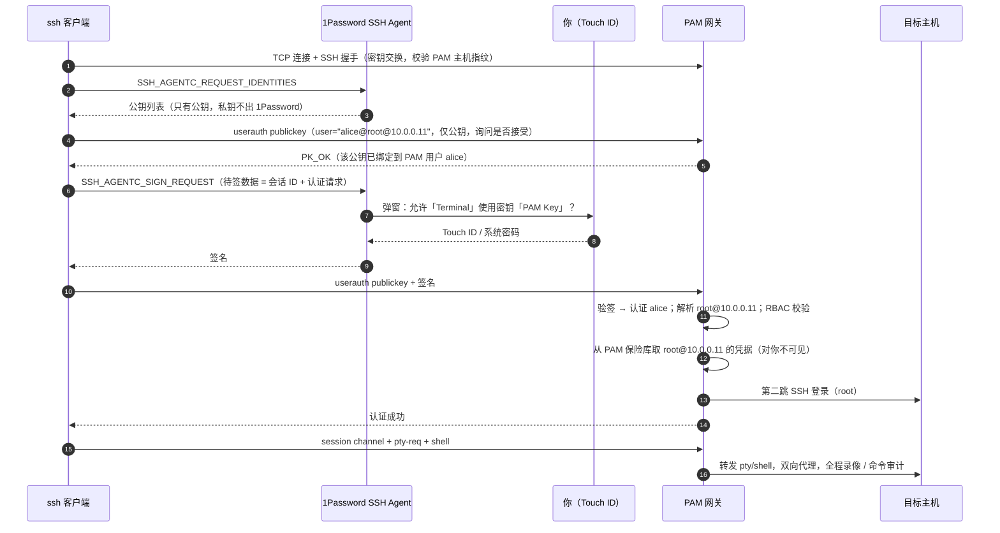
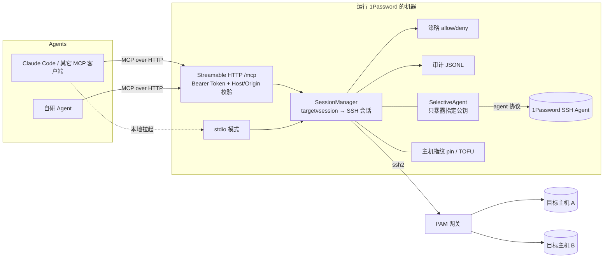
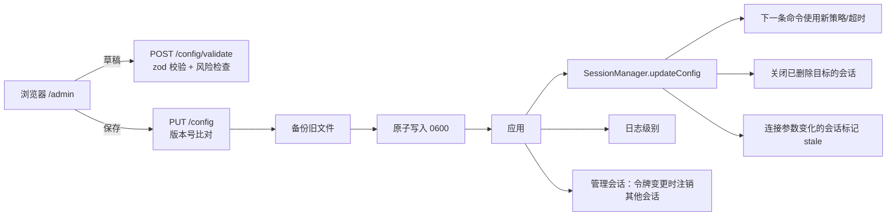

# pamssh-mcp 设计说明

本文回答三个问题：

1. 在终端里 `ssh username@account@hostname@pam_server` 时，1Password 为什么会自动弹窗、授权后就能登录？
2. 能否把这个能力做成一个 MCP Server，让 AI agent 通过 PAM 在目标机器上执行命令？
3. 具体怎么实现，有哪些坑。

---

## 1. 直连流程的技术拆解

### 1.1 参与方

| 角色 | 说明 |
| --- | --- |
| OpenSSH 客户端 | 终端里的 `ssh` |
| 1Password SSH Agent | 1Password 桌面端内置的 ssh-agent，监听 Unix socket（macOS：`~/Library/Group Containers/2BUA8C4S2C.com.1password/t/agent.sock`；Linux：`~/.1password/agent.sock`；Windows：命名管道 `\\.\pipe\openssh-ssh-agent`）|
| PAM 网关 | 堡垒机 / 特权访问管理（JumpServer、CyberArk PSMP、各类 PAM 产品的 SSH 代理）|
| 目标主机 | PAM 托管的资产，目标账号（如 root）的凭据由 PAM 保管 |

`~/.ssh/config` 里的 `IdentityAgent "~/Library/Group Containers/.../agent.sock"`（或环境变量 `SSH_AUTH_SOCK`）让 `ssh` 去找 1Password 的 agent，而不是读本地私钥文件。

### 1.2 用户名里的多个 `@`

OpenSSH 按 **最后一个** `@` 拆分目标：

```
ssh  alice@root@10.0.0.11@pam.example.com
     └──── 登录用户名 ────┘ └─ 连接的主机 ─┘
```

所以 TCP 连接只发往 `pam.example.com`，而 `alice@root@10.0.0.11` 整串作为 SSH 协议里的 *user name* 发给 PAM。PAM 网关自己解析这串：`alice` 是你的 PAM 个人账号，`root` 是目标账号，`10.0.0.11` 是目标资产。不同产品格式略有差异（分隔符、顺序、是否带端口），因此本项目把它做成可配置模板 `usernameTemplate`。

### 1.3 时序



几个关键点：

- **私钥从未被“取出来”。** 1Password 做的是“代签名”：ssh 把待签数据交给 agent，agent 在 1Password 进程内用私钥签名后返回签名。所谓“自动获取私钥”，本质是 *agent 协议 + 1Password 弹窗授权*。
- **只在认证阶段签一次名。** SSH 连接建立后，后续在该连接上执行任意多条命令都不需要再签名。这正是“保持登录态”的价值：一次授权，长期复用。
- **两跳认证互相独立。** 第一跳（你 → PAM）用你的个人密钥；第二跳（PAM → 目标）用 PAM 托管的目标账号凭据。你和 agent 都接触不到目标账号的密码或密钥。
- **授权的粒度在 1Password 设置里。** “Ask approval for each new: application / application and terminal session”，以及“记住授权直到 1Password 锁定 / 一段时间”。对一个常驻的 Node 进程来说，第一次连接会弹窗，之后在授权有效期内重连不再弹窗。
- **公钥过多的坑。** agent 里有很多公钥时，客户端会一个个试，大多数网关在约 6 次失败后断开（`Too many authentication failures`）。OpenSSH 用 `IdentitiesOnly` + `IdentityFile <公钥>` 解决，本项目用“只把指定公钥暴露给 SSH 库”的包装 agent 解决。

---

## 2. 可行性结论

**可行，而且不需要接触私钥。** 关键在于：Node 的 [`ssh2`](https://github.com/mscdex/ssh2) 库原生支持 OpenSSH agent 协议（`agent: <socket 路径>`），可以直接对接 1Password 的 agent socket，认证时由 1Password 弹窗签名，行为与终端里的 `ssh` 完全一致。

约束：

| 约束 | 说明 |
| --- | --- |
| 必须运行在装有 1Password 桌面端、且已解锁的机器上 | agent socket 是本机的。典型部署：开发者自己的 Mac 上常驻一个服务，本机或局域网内的 agent 通过 HTTP 调用 |
| 首次连接需要人工批准 | 1Password 会以 `node` 为请求方弹窗；`pam_open_session` 工具可以提前触发 |
| PAM 通常只支持交互式 shell | 很多网关不支持 `exec` 请求、SFTP 子系统、端口转发，所以默认走“PTY shell + 标记协议” |
| 二次认证 | 公钥之后的**无提示** keyboard-interactive 轮次会自动通过；需要输入 OTP 的网关当前不支持（见“后续”）|

---

## 3. 架构



源码对应关系：

| 模块 | 文件 |
| --- | --- |
| 配置加载与校验（zod） | `src/config.js` |
| 1Password agent 定位 | `src/paths.js` |
| 指定公钥、列出 agent 公钥、`op read` | `src/agent.js` |
| PAM 主机指纹校验 | `src/hostkeys.js` |
| 连接 PAM、错误解释 | `src/ssh/connection.js` |
| 持久 shell + 标记协议 | `src/ssh/shell-session.js` |
| exec 模式 | `src/ssh/exec-session.js` |
| 会话生命周期、重连、空闲回收、策略、审计 | `src/session-manager.js` |
| MCP 工具 | `src/mcp/tools.js` |
| Streamable HTTP / stdio | `src/mcp/http-server.js`、`src/mcp/stdio-server.js` |
| CLI | `src/cli.js` |

---

## 4. 关键设计

### 4.1 为什么默认是“持久 PTY shell”

- PAM 网关普遍只放行 `shell` 请求，`exec` 常被拒绝或被当成交互式会话处理。
- 需求本身就是“保持登录态”：`cd`、`export`、`source venv/bin/activate` 等状态要在多次调用间保留。
- 每次新建 SSH 连接都会触发一次签名（可能弹窗）和一次 PAM 登录记录，成本高。

对支持 `exec` 的网关，可以给目标配置 `"mode": "exec"`：复用同一条已认证连接，每条命令开一个 exec 通道，stdout/stderr 分离，但不保留 shell 状态。

### 4.2 标记协议

一个交互式 shell 是一条字节流，必须知道“这条命令的输出从哪开始、到哪结束、退出码是多少”。每条命令以如下形式写入：

```sh
printf '%s%s\n' '__PAMSSH_<nonce>_<seq>' '_B__'; eval '<命令，单引号转义>' </dev/null; printf '\n%s%s:%s:%s\n' '__PAMSSH_<nonce>_<seq>' '_E__' "$?" "$PWD"
```

| 设计 | 原因 |
| --- | --- |
| 标记由 `printf` 把两半拼起来 | 终端回显的是命令文本 `'__PAMSSH_x' '_B__'`，不含连续的标记串，回显永远不会被误判为标记 |
| 命令以明文发送（只把 `'` 转义成 `'\''`）| PAM 的录像和命令审计能看到真实命令。不用 base64 等编码，避免“审计不可读”，也避免被认为在绕过审计 |
| 外层单引号永远配平 | 命令里有未闭合的引号或语法错误时，表现为 `eval` 报错并返回非 0，而不是让 shell 卡在 PS2 续行提示 |
| `eval` 在当前 shell 执行 | `cd` / `export` / 函数定义能保留 |
| `</dev/null` | 命令读不到后续输入，`cat`、`read` 之类不会吞掉下一条命令或挂起 |
| 结束标记带 `$?` 和 `$PWD` | 返回退出码和当前目录，agent 能追踪状态 |

会话建立时先发一段 prelude：`stty -echo -onlcr`，关闭 bash readline（`set +o emacs`，避免 Tab 补全与 bracketed paste）和 `!` 历史展开，关闭 zsh 的 zle 并 `ttyctl -f`，清空 PS1/PS2，设置 `TERM=dumb`、`PAGER=cat` 等，最后打印 READY 标记。READY 之前的一切（PAM 横幅、MOTD、回显）都被丢弃。

踩过的坑（都有测试覆盖）：

- 最初用 `eval "$(cat <<'EOF' … EOF)"` 包裹命令；**bash 3.2 遇到 heredoc 里未配平的引号会解析错 `$(...)`**，整个 shell 卡住。改成单引号 `eval` 后，bash 3.2 / bash 5 / zsh / sh 都正常。
- **zsh 在前台任务被 Ctrl-C 杀掉后会恢复它记住的 tty 模式（重新打开回显）**，用 `ttyctl -f` 冻结，并在超时同步行里再执行一次 `stty -echo`。
- 规范模式（canonical）下终端一行最多 4095 字节，超出部分会被**静默截断**，截断后的命令可能变成另一条危险命令。所以单行超过 4000 字节的命令直接拒绝。
- 控制字符（`\x03`、`\x04`、`\x1a` 等）会被终端行规程解释成信号，命令里只允许 `\n` 和 `\t`。

### 4.3 超时与恢复

超时后发送 `Ctrl-C`，这时交互式 shell 会放弃当前命令行，原本的结束标记不会再打印。于是再补发一行“同步行”（`stty -echo; printf <结束标记> 130 "$PWD"`），并且从超时那一刻起停止收集输出。5 秒内仍收不到结束标记，就判定会话已坏，关闭它，下次调用自动重新登录，返回结果里带 `reconnected: true`，提示 agent 之前的 cwd/env 已丢失。

### 4.4 会话模型

- 会话键是 `(target, session 名)`，默认名为 `default`。不同名字就是不同的 PAM 登录，互相隔离，适合并行任务。
- 同一会话内的命令严格串行（队列）。
- 会话在所有 MCP 客户端之间共享：服务就是那个“持有登录态的地方”。
- 远端 `exit`、网关空闲断开、网络中断时，会话被标记为断开，下次调用自动重连。
- 空闲超过 `idleTimeoutMinutes`（默认 30 分钟）自动登出，释放特权会话。
- 每个目标的会话数上限 `maxSessionsPerTarget` 只计“持有登录”的会话（已连接、正在连接、正在执行命令）。登录失败或已断开的会话不占名额，保留 10 分钟显示最后的错误后清理；重新启用它需要有空闲名额。
- 会话因空闲超时、断线或清理而重建时，同名会话的下一次调用会带 `reconnected: true`；agent 主动 `pam_close_session` 后再用则是普通新会话。

### 4.5 真实网关验证中发现并修复的问题

在一台真实网关（OpenSSH 跳板 → 会话录像 → 目标主机）上验证时，又暴露了三个 mock 没覆盖到的问题，均已修复并补了测试：

| 现象 | 原因 | 处理 |
| --- | --- | --- |
| 1Password 已签名，仍报 `PAM authentication failed` | 网关配置了 `AuthenticationMethods publickey,keyboard-interactive`：公钥通过后（partial success）还要求一轮 keyboard-interactive。这一轮**没有任何提示问题**，OpenSSH 客户端会自动应答，所以终端里感知不到 | 启用 `tryKeyboard`。无提示的轮次自动应答；**一旦出现真实提示（OTP、密码），不发送任何内容**，直接报错并列出提示文本，避免误答导致 2FA 失败计数或锁号 |
| 登录后报 `did not become a usable POSIX shell`，但输出里能看到目标提示符 | 多跳登录：网关主机 MOTD → 录像 → 第二跳 ssh 到目标。shell 通道一打开就发送的初始化命令，在目标 shell 启动前被中间环节丢弃 | 先等登录输出“稳定”（出现提示符后 300ms，或无输出 1.5s，可配置 `shell.settleMs`），再发送初始化命令；收不到 READY 时每 4s 重发一次（初始化命令是幂等的）。真实网关上第 1 次被丢弃、第 2 次成功，约 7s 就绪 |
| 大输出结果被 Claude Code 转存到文件 | 默认输出上限 60000 字符，超过了 Claude Code 单个 MCP 工具结果约 25k token 的上限 | 默认值降到 20000 字符；同时把 `\r` 进度条输出折叠为终端最终显示的内容 |

### 4.6 安全

| 风险 | 措施 |
| --- | --- |
| 任何能访问 HTTP 端口的人都能拿到特权 shell | 默认只监听 `127.0.0.1`；强制 Bearer Token（常量时间比较）；校验 Host 头防 DNS rebinding；有 Origin 头时必须在白名单内；绑定到非回环地址时启动告警 |
| agent 执行危险命令 | 全局 + 目标级 allow/deny 正则。**这只是护栏，不是安全边界**，正则很容易绕过；真正的边界是 PAM 的 RBAC 和目标账号权限 |
| 事后追溯 | 本地 JSONL 审计（每条命令的请求方、目标、登录串、退出码、耗时，不记录输出以免泄露机密），并保留 PAM 自身的录像审计 |
| 中间人 | PAM 主机指纹可在配置中 pin；未 pin 时首次使用时记录（TOFU），之后变化即拒绝 |
| 用错密钥 / 暴露过多公钥 | `identity` 精确选择一把公钥（指纹 / 公钥 / 1Password 条目标题 / `op://` 引用）|
| 私钥泄露 | 私钥始终在 1Password 内，本服务只拿到签名；不做 agent forwarding |
| 配置与令牌泄露 | 配置文件、审计文件、known_hosts 均以 0600 写入，目录 0700 |
| agent 修改约束自己的策略 | 管理页面使用独立的 `adminToken`，配置校验禁止与 MCP 令牌相同；MCP 令牌访问不了 `/admin`，管理令牌也访问不了 `/mcp` |
| 管理页面被跨站利用 | 令牌只在登录时提交，换成服务端随机会话 ID（HttpOnly、SameSite=Strict、Path=/admin，空闲 60 分钟、最长 12 小时过期）；写操作要求自定义请求头且 Origin 必须是本站；严格 CSP（只允许同源脚本和样式，禁止被嵌入 iframe）；页面不使用 innerHTML 渲染数据；同一来源连续 5 次登录失败锁定 15 分钟 |
| 管理页面泄露令牌 | 读取配置时令牌被替换为占位符，保存时服务端再换回原值；只有点“显示”才返回明文，并记入日志 |

### 4.7 管理页面与配置热更新



- **单一字段元数据**：`src/admin/fields.js` 描述每个配置字段的标签、说明、默认值、示例、单位、是否需重启等；前端据此生成表单。测试会遍历 zod schema，确保每个字段都有说明、没有过期条目。
- **配置文件即真相**：页面编辑的是磁盘上的原始 JSON（未填的字段保持缺省，由默认值生效），不会把默认值写进文件。
- **并发保护**：保存时带上读取时的版本号（文件内容哈希），文件被手工修改过就返回 409，不覆盖。
- **热更新边界**：除监听地址、端口、MCP 路径外都能热更新；已建立的 SSH 连接不会被打断，标记为 stale，关闭后按新配置重连。

### 4.8 管理页面终端

终端页不是原始 PTY 透传，而是复用 agent 使用的“持久 shell + 标记协议”：

- 每条命令走 `SessionManager.exec`，因此同样经过命令策略、写入审计（来源 `admin-ui`）、受超时和输出上限约束，与 agent 看到的结果完全一致。
- 输出通过 `onOutput` 回调实时推送：`POST /admin/api/shell/exec` 返回 NDJSON 流（`start` → 多个 `output` → `result`/`error`），浏览器用 fetch 流读取，不需要 WebSocket，也不放宽 CSP。命令结束后用最终结果（截断、去控制字符后的版本）替换实时输出。
- `Ctrl-C` 调用 `POST /admin/api/shell/interrupt`，走与超时相同的中断路径（发送 `^C`，再补发结束标记），会话保持可用；结果带 `interrupted: true`。
- 选择原始 PTY 的代价太高：绕过策略和逐条审计、与 agent 共享会话时会破坏标记协议、还需要额外依赖。交互程序（vim、top）因此不支持，这与 agent 的约束一致。

### 4.9 审计保留

`audit.retentionDays`（默认 30 天）。`serve` / `stdio` 启动时清理一次，之后每 6 小时一次；在管理页面改小保留天数保存后立即清理。清理按每行的 `ts` 判断，读不出时间的行保留；只有确实删除了记录时才以 0600 原子重写文件。关闭审计后已有记录仍会按期限过期。

---

## 5. 局限与后续

- **OTP 类二次认证**：网关在公钥之后真的要求输入验证码时，当前会直接报错（不发送任何内容）。可以扩展为显式配置后用 `op read "op://vault/item/one-time password?attribute=otp"` 应答。
- **非 POSIX 目标**：网络设备 CLI、Windows 目标、带交互菜单的 PAM 不适用标记协议，需要另做“原始交互”工具（发送按键、按提示符等待）。
- **文件传输**：PAM 往往限制 SFTP/SCP。可以基于 shell 做 `base64` 分块上传，但会降低审计可读性，需要和安全团队确认。
- **stderr 分离**：PTY 模式下 stdout/stderr 合并；需要分离时用 exec 模式。
- **多人共享部署**：本设计依赖“个人 1Password + 个人 PAM 账号”，适合每人在自己机器上跑一个实例。做成团队共享服务意味着用服务账号和集中授权（OAuth），这是另一个信任模型。
- **无人值守**：1Password Service Account 不提供 SSH agent。如果必须无人值守，只能 `op read` 私钥后交给 ssh2 的 `privateKey`，私钥会进入进程内存，风险更高，默认不支持。

---

## 6. 验证

`npm test` 覆盖：

- 配置校验、用户名模板、策略规则、主机指纹 TOFU / pin
- 标记解析器在任意分块边界下的正确性，以及中断、残留标记、截断
- 包装后的命令在真实 `/bin/sh` 中执行：引号、`$`、反斜杠、语法错误、读 stdin 的命令
- 端到端：真实 `ssh-agent`（代替 1Password，agent 里放两把密钥以验证选钥）→ ssh2 → `examples/mock-pam-server.js`（按 `user@account@host` 解析、公钥验签）→ 真实 PTY 中的 bash，覆盖状态保持、命名会话、超时恢复、远端 exit 后重连、exec 模式、策略拦截、错钥 / 未注册公钥 / 主机指纹不符的报错，以及通过官方 MCP SDK 客户端走 Streamable HTTP 调用全部工具和鉴权拦截

另外在 macOS 上用 bash 3.2、zsh、sh 三种 shell 手工跑过同一组用例。
